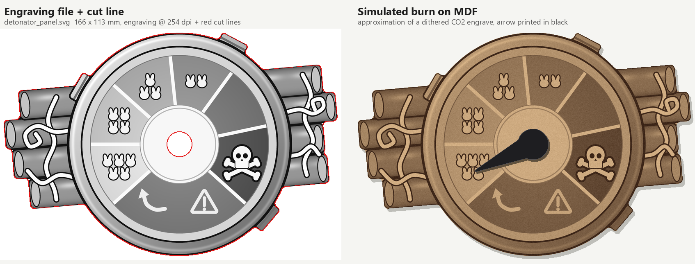
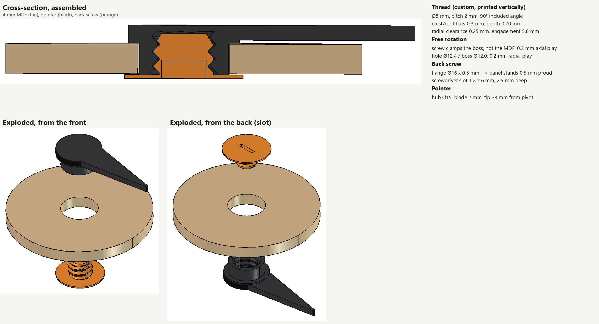

# Bomb Busters detonator

A 1:1 recreation of the detonator dial from `docs/picture_detonator.jpg`: a
laser-cut and engraved 4 mm MDF panel with a two-part 3D-printed pointer that
screws together through the panel and rotates freely.



## Files to use

| File | What |
|---|---|
| `out/detonator_panel.svg` | **Send this to the laser.** Grayscale engraving (embedded, 254 dpi, 1:1) plus red cut lines. 166 × 113 mm. |
| `out/tone_test.svg` | Calibration strip with the exact gray levels used on the panel. Burn it first. |
| `out/arrow_front.stl` | Pointer, already oriented face-down for printing. |
| `out/arrow_back.stl` | Back screw, oriented flange-down. |
| `out/thread_test.stl` | Three bolt + nut pairs to check the thread fit. Print it first. |
| `out/arrow.step` | Both arrow parts as a STEP file, for other CAD tools. |
| `cad/detonator.FCStd` | FreeCAD document: panel, arrow and thread test, plus a `Params` sheet. |

## Laser (CO2, LightBurn)

1. **Import.** Use *File → Import* on `detonator_panel.svg`. The image lands on an image layer and the red paths on a line layer. Check that the size reads 166.3 × 113.0 mm and don't rescale it.
2. **Image layer settings:**
   - Mode Jarvis (or Stucki), 254 DPI (0.1 mm line interval), bidirectional, overscan on.
   - Starting point on a 40–60 W tube: about 300 mm/s at 15–25 % max power.
   - Dithering only uses max power, so tune the darkness with power and speed.
3. **Cut layer settings** for 4 mm MDF:
   - Line mode, about 15–20 mm/s at 60–70 %, 1 pass, air assist on.
   - In *Optimization Settings*, enable *Cut inner shapes first* so the pivot hole is cut before the outline frees the part.
4. **Layer order:** engrave first, cut last.
5. **Calibrate.** Burn `tone_test.svg` with the same settings first. The 255 patch should stay untouched, and every step down to 18 should get visibly darker.
   - If the middle steps run together, lower the power or raise the speed. Adjust until 222 → 84 spread nicely.
   - 124 (purple sector) and 118 (orange-red) are meant to be close. Those two sectors don't touch each other.
6. **Clean up.** Optionally mask the sheet, or wipe off smoke residue afterwards with a slightly damp cloth.

## 3D print (FDM, 0.4 mm nozzle)

- **Print `thread_test.stl` first.** The nuts carry 1, 2 or 3 notches, which mean 0.15, 0.25 or 0.35 mm of radial clearance. Pick the tightest pair that still turns smoothly by hand, set `THREAD_CLEAR` to that value and regenerate. The default is 0.25.
- **Material:** PLA or PETG, black for the pointer.
- **Supports:** none. The STLs are already in print orientation, and all threads print with their axis vertical.
- **`arrow_front.stl`:**
  - It prints with the visible top face on the bed.
  - Use 0.15 mm layers, 3–4 walls, 100 % infill.
- **`arrow_back.stl`:**
  - The flange is only 0.5 mm thick. Use a 0.2 mm first layer, then 0.1 mm layers.
  - Turn on elephant-foot compensation so the flange stays flat and the slot stays open.

## Assembly

1. From the front, put the pointer's boss through the pivot hole.
2. From the back, screw in the back part with a small flat screwdriver until it stops. It stops against the end of the boss, not against the MDF, so tightening it fully still leaves 0.3 mm of axial play and the pointer rotates freely.
3. If you want it permanent, put a drop of glue on the thread before the last turn.



## Key dimensions

| Item | Value |
|---|---|
| Dial (bezel) | Ø 109 mm |
| Pivot hole / boss | Ø 12.4 mm / Ø 12.0 mm, giving 0.2 mm radial play |
| Axial play | 0.3 mm (boss length = MDF thickness + 0.3) |
| Thread | Custom Ø 8 mm, pitch 2 mm, 45° flanks, 0.3 mm crest/root flats, 0.25 mm radial clearance, 5.6 mm engagement |
| Back flange | Ø 16 × 0.5 mm, so the panel sits 0.5 mm above the table |
| Screwdriver slot | 1.2 × 6 mm, 2.5 mm deep |
| Pointer | Hub Ø 15 mm, blade 2 mm thick, tip 33 mm from the pivot |

Why a custom thread: printed threads below M5–M6 are unreliable. A coarse pitch with 45° flanks and flattened crests prints cleanly when the axis is vertical, and a short test print settles the clearance.

## Changing things / regenerating

All dimensions live in `src/params.py`. Measure your MDF with calipers and set `MDF_T`; if your kerf makes the hole loose, adjust `HOLE_D`. Then regenerate:

```bash
.venv/Scripts/python detonator/src/panel.py
.venv/Scripts/python detonator/src/tone_test.py
```

Next, with FreeCAD open, run `cad/build.py` and then `cad/preview_cad.py` inside FreeCAD. Use either the FreeCAD MCP / RPC `execute_code`, or paste `exec(open(r"<path>").read())` into FreeCAD's Python console. `build.py` rebuilds `detonator.FCStd` and the STL and STEP files, and prints the fit checks: overlaps (should be 0) and play values.

Finally, refresh the preview images:

```bash
.venv/Scripts/python detonator/src/previews.py
```

The project venv needs `shapely pillow numpy matplotlib`.
